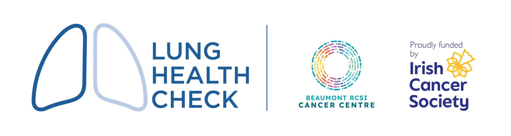

# BRAND cfDNA methylation

<p align="center">
  
</p>

Code for the plasma cell-free DNA (cfDNA) methylation analyses in:

**Multimodal genomic features in exhaled breath and plasma in advanced non-small cell lung cancer.**
O'Reilly D, Ogundimu F, *et al.* Manuscript under review. The full author list is under [Citation](#citation).

The samples come from BRAND (Biomarkers of Response to Immunotherapy in Advanced NSCLC using Dynamic Breath and Blood Analysis), a prospective study of patients with advanced non-small cell lung cancer (NSCLC) starting immune checkpoint inhibitor therapy. Plasma cfDNA from 42 patients with paired baseline and early on-treatment (week 3 or 6) samples was sequenced with the Twist Human Methylome Panel after enzymatic methyl conversion (NEBNext EM-seq).

This repository covers the methylation analyses only. The exhaled breath condensate (EBC) and ctDNA analyses (Figure 1, Extended Data Figure 1, Supplementary Figure 1 and the EBC and ctDNA rows of Supplementary Tables 2 and 4) were run separately in R and are not included.

## What the code does

1. **DMR discovery inside cross-validation.** In each of 42 leave-one-out folds, Metilene v0.2-9 is re-run on the 41 training patients to find differentially methylated regions (DMRs) between patients with and without durable clinical benefit (DCB, progression-free survival (PFS) of 6 months or longer).
2. **36-DMR panel.** The 36 DMRs found in all 42 folds form the panel. It is evaluated out of fold with an L1-penalised logistic regression (C = 0.1, scored by AUC) and a ridge-penalised Cox model (penaliser 0.5, scored by Harrell's C-index), each with 2,000-iteration bootstrap confidence intervals. Panel membership draws on all 42 patients' labels, so, as the manuscript states, these estimates are internally cross-validated rather than externally validated.
3. **On-treatment samples.** The same 36 regions are measured in the on-treatment samples on the baseline CpG set. For Figure 2D, each patient's on-treatment sample is scored by the classifier trained on the other 41 baseline samples. For the dynamic analysis (Figure 2E), the baseline classifier is refitted on all 42 baseline samples to score the on-treatment samples, each patient's baseline score is their out-of-fold value, and the pre-specified tests relate the change in score to PFS.

## Manuscript items and the scripts that produce them

| Manuscript item | Script | Output |
|---|---|---|
| 2,526 DMRs at the cohort level (Results) | Metilene on Galaxy (default settings), with inputs prepared in `notebooks/Metilene/BRAND_Metilene_Galaxy_Prep.ipynb` | `results/metilene/galaxy_results/run3_baseline_dmrs.txt` |
| 36-DMR panel (DMRs found in all 42 folds) | `scripts/run_loocv.py` | `results/sensitivity_analysis/dmr_stability.csv` (rows with `fold_count` 42) |
| Figure 2C: baseline 36-DMR classifier | `scripts/run_sensitivity.py` | `sensitivity_36dmr.csv`\* |
| Supplementary Figure 3: baseline continuous risk score | `scripts/run_continuous_validation.py`, then `scripts/build_supplementary_figures.py` | `continuous_validation.csv`\*, `figures/supplementary/supplement_km_36dmr.png` |
| On-treatment 42 x 36 methylation matrix | `scripts/build_fu_dmr36_matrix.py` | `dmr36_matrix_fu.csv`\* |
| Figure 2D and Supplementary Table 4 (36-DMR row) | `scripts/run_fu_alone_battery.py` | `results/sensitivity_analysis/fu_alone_battery.csv` |
| Figure 2E and the pre-specified dynamic tests | `scripts/run_fu_dynamic_analysis.py` | `fu_dynamic_results.csv`\*, `results/sensitivity_analysis/fu_dynamic_region_tests.csv` |
| Supplementary Table 2 (36-DMR row) | `scripts/test_ph_assumption_methylation.py` | `results/sensitivity_analysis/ph_assumption_methylation.txt` |
| Figure 2, panels A to E | `scripts/build_paper_figure_composite.py` | `figures/figure2_composite.png` |
| Supplementary Figure 2 and Supplementary Table 3 | `scripts/build_supplementary_figures.py`, then `scripts/annotate_36dmrs.py` | `figures/supplementary/supplement_forest_36dmr.png`, `figures/supplementary/supplement_table_36dmr.csv` |

\* Patient-level file, produced when the pipeline runs and not included in this repository (see [Data availability](#data-availability)).

Notes for checking numbers against the manuscript:

- `run_fu_alone_battery.py` treats no DCB as the positive class. Supplementary Table 4 treats DCB as positive, so the manuscript's PPV, NPV, sensitivity and specificity are the script's NPV, PPV, specificity and sensitivity.
- `run_fu_dynamic_analysis.py` reports the Cox hazard ratio per 0.1-unit increase in the non-responder probability (3.30). The manuscript reports the same model per 0.1-unit change toward responder, which is the reciprocal (0.30).
- Supplementary Table 2 reports the Schoenfeld residual test with the `km` time transform, the default in R's `cox.zph`. `test_ph_assumption_methylation.py` prints the `rank`, `km` and `identity` transforms.

## Data availability

The per-sample methylation data, the clinical outcome table and the per-patient model outputs contain participant information and are not distributed here. Requests for access should go to the corresponding author, David O'Reilly (doreill4@jh.edu). This repository contains the code and the summary-level outputs listed above, none of which contain patient-level data.

To run the pipeline, place the inputs at these paths:

| Path | Contents | Used by |
|---|---|---|
| `scripts/cleaned_bedgraphs/` | Baseline Bismark CpG bedGraphs, one per patient (raw `PN0634_*.bedGraph.gz` files placed here are cleaned on the first run) | `run_loocv.py` |
| `scripts/BRAND_merged_analysis_dataset.csv` | Clinical table with `Patient_ID`, `PFS Months`, `OS Months` and the event indicators `PFS` and `OS` (1 = event, 0 = censored); the notebook also reads `Baseline_Sample_ID` and `Followup_Sample_ID` | `run_loocv.py` |
| `scripts/sample_mapping.csv` | Sample mapping with `patient_id`, `timepoint` (`baseline` or `follow-up`), `sample_num` and `filepath` (Bismark file name) | `run_loocv.py` |
| `scripts/loocv42_clinical.csv` | `patient_id` plus age, ECOG, PD-L1 range, smoking status, gender and histology, used only by the clinical-only and combined comparison models (not reported in the manuscript) | `run_sensitivity.py` |
| `database_files/bedgraph_files/*.bedGraph.gz` | Baseline and on-treatment Bismark CpG bedGraphs | `build_fu_dmr36_matrix.py`, Galaxy preparation notebook |
| `database_files/metadata/sample_mapping.csv` | Same mapping as above | `build_fu_dmr36_matrix.py`, Galaxy preparation notebook |
| `database_files/metadata/BRAND_merged_analysis_dataset.csv` | Same clinical table as above | Galaxy preparation notebook |
| `database_files/metadata/Ensembl_Gene_ID_For_Annotation.txt` | Gene coordinates (chromosome, start, end, gene) for annotating the Galaxy output | Galaxy preparation notebook |

## Software

- Python 3.14 with the package versions in `requirements.txt` (`pip install -r requirements.txt`). The notebook also needs Jupyter.
- Metilene v0.2-9, compiled so that the binary is at `scripts/metilene_v0.2-9/metilene`.
- A SLURM cluster for the leave-one-out step. Each fold runs Metilene on 41 baseline samples; we used 8 CPUs, 64 GB of memory and a 24-hour limit per fold.
- Internet access for `annotate_36dmrs.py`, which queries the Ensembl REST API (GRCh38).

## Running the analysis

Steps 1 and 2 run on the cluster from `scripts/` and write to `scripts/results/`. The later steps run from the repository root and read from `results/sensitivity_analysis/`.

```bash
# 1. Leave-one-out DMR discovery, one fold per SLURM array task.
#    Fold 0 also writes the filtered CpG matrix, so run it on its own first.
cd scripts
sbatch submit_loocv_array.sh                       # fold 0 (the script's default)
sbatch --array=1-41%5 submit_loocv_array.sh        # after fold 0 has finished

#    Combine the per-fold results and write results/loocv_results_final.csv
#    and results/dmr_stability.csv
awk 'FNR == 1 && NR != 1 {next} {print}' results/fold_*.csv > results/loocv_results_incremental.csv
python run_loocv.py --skip-to-results

# 2. 36-DMR panel at baseline: out-of-fold classifier scores and the 42 x 36 matrix
python run_sensitivity.py

# 3. Copy the outputs that the later steps read
cp results/{loocv_results_final,dmr_stability,sensitivity_36dmr,dmr36_matrix}.csv ../results/sensitivity_analysis/
cd ..

# 4. Baseline continuous risk score (ridge Cox, C-index)
python scripts/run_continuous_validation.py

# 5. On-treatment 36-DMR matrix on the baseline CpG set
python scripts/build_fu_dmr36_matrix.py

# 6. On-treatment classifier and Cox models
python scripts/run_fu_alone_battery.py

# 7. Pre-specified dynamic-change tests
python scripts/run_fu_dynamic_analysis.py

# 8. Proportional hazards tests (Supplementary Table 2)
python scripts/test_ph_assumption_methylation.py > results/sensitivity_analysis/ph_assumption_methylation.txt

# 9. Figure 2, Supplementary Figures 2 and 3, and Supplementary Table 3
python scripts/build_paper_figure_composite.py
python scripts/build_supplementary_figures.py
python scripts/annotate_36dmrs.py
```

## Repository layout

```text
.
├── scripts/                     analysis scripts, in the run order above
│   └── submit_loocv_array.sh    SLURM array job, one leave-one-out fold per task
├── notebooks/Metilene/          input preparation for the cohort-level Galaxy Metilene run
├── results/
│   ├── metilene/galaxy_results/ cohort-level Metilene output (2,526 DMRs, q < 0.05)
│   └── sensitivity_analysis/    summary-level outputs (patient-level files are written here but not tracked)
├── figures/                     figure outputs; supplementary/supplement_table_36dmr.csv is Supplementary Table 3
├── assets/                      banner image
├── requirements.txt
└── LICENSE
```

## Citation

O'Reilly D, Ogundimu F, Dunne J, Dowling G, Marks S, Barry SL, Moloney-Lineen C, Moran L, Kieran R, Cluxton C, Kirwan L, Deac O, McNevin CS, Hadi D, Dillon R, Moyle J, Clarke R, O'Leary C, Toland S, Reilly A, O'Grady A, Cummins R, Ryan DJ, Morgan R, Sulaiman I, O'Brien E, Breathnach O, Grogan L, Morris PG, Murphy A, Greally M, Teo MY, McLaughlin R, Martin P, Egan K, Dowling CM, Forde PM, Cuffe S, Barr MP, Gately K, Mullan P, Cotter S, Furney S, Madden S, Toomey S, Hennessy BT\*, Naidoo J\*. Multimodal genomic features in exhaled breath and plasma in advanced non-small cell lung cancer. Manuscript under review.

\* Joint senior authors.

## Contact

- Corresponding author: David O'Reilly (doreill4@jh.edu)
- Code: Faith Ogundimu, Genomic Oncology Research Group, RCSI University of Health Sciences. Please open a GitHub issue.

## Funding and acknowledgements

This work was funded by an International Association for the Study of Lung Cancer Adi F. Gazdar Fellowship Award, an ASCO Conquer Cancer Young Investigator Award, an Irish Cancer Society Clinician Research Development Fellowship, the Charitable Infirmary Charitable Trust and the RCSI StAR MD Programme. We thank the patients and families who took part in BRAND, the Cancer Clinical Trials Unit at Beaumont RCSI Cancer Centre, Ms Michelle Connolly and Ms Aileen Walsh.

## Licence

The code is released under the MIT Licence (see `LICENSE`).
